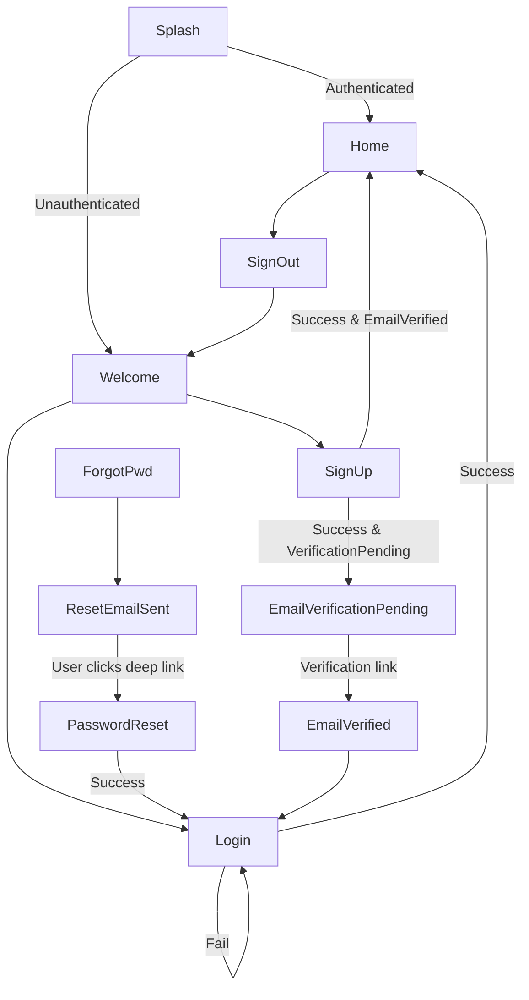

# DayMark Authentication – Specification (SPEC.md)

---

## 1. Functional Requirements
| ID | Requirement |
|----|-------------|
| **FR‑01** | The app shall provide **registration**, **login**, **forgot‑password**, **password‑reset**, **email‑verification**, and **sign‑out** flows using **Supabase Auth**. |
| **FR‑02** | Registration requires **email** and **password** only (no name). |
| **FR‑03** | Email inputs are trimmed of surrounding whitespace before validation/submission. |
| **FR‑04** | Password inputs are **preserved exactly** (no trimming) and must be at least **8 characters**. |
| **FR‑05** | Validation errors must be surfaced to the UI before calling Supabase. |
| **FR‑06** | All authentication‑related network errors surface a `NetworkException`. |
| **FR‑07** | Authentication state is managed with **Bloc/Cubit** and persisted securely (see Security Requirements). |
| **FR‑08** | GoRouter must protect all **authenticated** routes; unauthenticated users are redirected to the **Welcome** flow. |
| **FR‑09** | Deep‑link callbacks for **password‑reset** and **email‑verification** must be reachable while the user is unauthenticated. |
| **FR‑10** | The app shall distinguish **local sign‑out**, **global sign‑out**, **refresh‑token revocation**, and **access‑token expiry** (see States). |
| **FR‑11** | All acceptance criteria listed below must be met. |

## 2. Screen Requirements
| Screen | Purpose | Navigation |
|--------|---------|------------|
| **Splash / Session Check** | Detect existing session; route accordingly. | → *Home* (if authenticated) or → *Welcome* (if not). |
| **Welcome** | Entry point for unauthenticated users. | → *Login* / *Sign‑up*. |
| **Login** | Email + Password entry. | On success → *Home*; on failure → show error. |
| **Sign‑up** | Email + Password entry (no name). | On success → *EmailVerificationPending* (if verification required) or → *Home*. |
| **Forgot Password** | Request password‑reset email. | → shows confirmation. |
| **Password Reset** (deep‑link) | Enter **new password** + **confirm password**. | On success → *Login*. |
| **Email Verification** (deep‑link) | Handles email‑verification token. | On success → *Login* (if pending) or → *Home*. |
| **Home** | Main app content (protected). | Requires authentication. |
| **Settings → Sign‑out** | Initiates sign‑out flow. | Leads to *Welcome*. |

## 3. Navigation Flow (GoRouter)

- **Protected routes** (`Home`, any feature screens) require `Authenticated` state.
- **Callback routes** (`/reset-password`, `/verify-email`) are **public** (no auth guard) to allow handling of deep links.

## 4. Input Contracts
| Flow | Field | Type | Required | Validation Rules |
|------|-------|------|----------|-------------------|
| **Register** | Email | `String` | Yes | Trim whitespace, valid email pattern. |
|  | Password | `String` | Yes | Preserve exactly, minimum 8 characters. |
| **Login** | Email | `String` | Yes | Trim, valid email. |
|  | Password | `String` | Yes | Preserve exactly. |
| **Forgot Password** | Email | `String` | Yes | Trim, valid email. |
| **Password Reset** | New password | `String` | Yes | Preserve exactly, minimum 8 characters. |
|  | Confirm password | `String` | Yes | Exact match to new password. |

*No “name” field is present in any flow.*

## 5. Custom Exception Contracts
All application‑specific exceptions extend **`AppAuthException`**.
| Exception | When Thrown |
|-----------|------------|
| `InvalidCredentialsException` | Supabase returns “invalid credentials”. |
| `UserAlreadyExistsException` | Registration email already registered. |
| `WeakPasswordException` | Password < 8 chars (client‑side). |
| `EmailNotVerifiedException` | Login attempted with an unverified email (no session). |
| `EmailVerificationPendingException` | Registration succeeded but email verification is pending. |
| `NetworkException` | Any network‑layer failure. |
| `SessionExpiredException` | Refresh token invalid/expired. |
| `UnknownAuthException` | Catch‑all for any other Supabase `AuthException`. |
| `AppAuthException` | Base class for all above. |

## 6. Authentication States (Bloc/Cubit)
| State | Meaning |
|-------|---------|
| `Initial` | App just started; session check pending. |
| `Loading` | Any auth request in progress. |
| `Authenticated` | Valid session present; token usable. |
| `Unauthenticated` | No session or session cleared. |
| `EmailVerificationPending` | User registered; email verification required before login. |
| `Error` | Holds an `AppAuthException` for UI display. |

## 7. Session Requirements & Security
- **Supabase session persistence** is **not assumed to be encrypted**; the implementation must verify that the stored session uses a **secure enclave** (e.g., `flutter_secure_storage` or platform‑specific Keychain/Keystore).
- **Never** store raw passwords or tokens in plain `SharedPreferences`.
- **Refresh‑token** handling must respect Supabase’s recommended secure storage and renewal flow.
- **Access‑token** is stored only in memory; it is refreshed automatically when needed.

## 8. Boundary Conditions
| Condition | Expected Behavior |
|-----------|-------------------|
| Empty email | UI shows “Email required”. |
| Invalid email format | UI shows “Enter a valid email”. |
| Password < 8 chars | UI shows “Password must be at least 8 characters”. |
| Password mismatch on reset | UI shows “Passwords do not match”. |
| Login with unverified email | Throw `EmailNotVerifiedException`; UI prompts “Verify your email”. |
| Registration with existing email | Throw `UserAlreadyExistsException`. |
| Network outage | Throw `NetworkException`. |
| Refresh‑token revoked | Throw `SessionExpiredException`; user is signed out. |
| Deep‑link opened while unauthenticated | Flow proceeds (password reset or email verification) without redirection to Welcome. |
| Authenticated user accesses Welcome/Sign‑up | Redirected to Home. |
| Verification‑pending user attempts Home | Redirected to a “Verify Email” notice page (still unauthenticated). |
| Global sign‑out (e.g., revoke on server) | Session cleared locally; user sees `Unauthenticated` state. |
| Local sign‑out | Clears local storage; user sees `Unauthenticated`. |

## 9. Security Requirements
| # | Requirement |
|---|-------------|
| **SEC‑01** | All communications with Supabase use **HTTPS** with TLS 1.2+. |
| **SEC‑02** | Client‑side storage of tokens uses **secure storage** (encrypted keychain/keystore). |
| **SEC‑03** | Passwords are never logged, trimmed, or persisted. |
| **SEC‑04** | Email addresses are trimmed **only** before validation/submission. |
| **SEC‑05** | The app does **not** embed Supabase service‑role keys; only public client keys are used. |
| **SEC‑06** | Deep‑link URLs are verified against Supabase’s signed callback tokens before any state change. |
| **SEC‑07** | Rate‑limit authentication requests on the client side to mitigate credential‑stuffing attacks. |
| **SEC‑08** | All exception messages exposed to the UI are **user‑friendly**; internal error details remain hidden. |

## 10. Acceptance Criteria
| ID | Criterion |
|----|-----------|
| **AC‑01** | **Registration** succeeds when a valid, trimmed email and a password ≥ 8 chars are provided; no “name” field is required. |
| **AC‑02** | **Login** succeeds only with a verified email; unverified email yields `EmailNotVerifiedException`. |
| **AC‑03** | **Forgot‑Password** sends a Supabase password‑reset email; deep‑link callback reaches the **Password Reset** screen while unauthenticated. |
| **AC‑04** | **Password Reset** validates new password (≥ 8 chars) and exact confirmation; on success redirects to **Login**. |
| **AC‑05** | **Email Verification** deep‑link processes token while unauthenticated and moves the user to **Login** with a “verification completed” notice. |
| **AC‑06** | **GoRouter** protects all authenticated routes; unauthenticated attempts are redirected to **Welcome** (except the two callback routes). |
| **AC‑07** | **Session persistence** uses a verified secure storage mechanism; failure to locate a secure store aborts app start with an error. |
| **AC‑08** | **Sign‑out** correctly distinguishes local vs. global sign‑out and clears appropriate tokens; UI returns to **Welcome**. |
| **AC‑09** | All custom exceptions extend `AppAuthException` and are mapped to appropriate UI error messages. |
| **AC‑10** | All boundary conditions listed in §8 are enforced with the exact UI messages described. |
| **AC‑11** | No references to a “name” field appear anywhere in the spec or UI designs. |

---

**Artifact Metadata**
- **UserFacing:** true
- **RequestFeedback:** false
- **Summary:** Authentication specification for DayMark project
